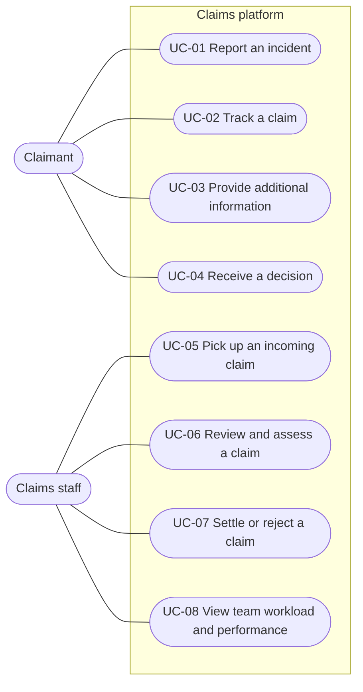

# 2. Use cases

One use case per requirement in the [RTM](01-requirements-traceability-matrix.md), so the numbers line up (UC-01 ↔ R1).
Actors are the two user types in the brief's requirement paragraphs. Mermaid has no native use case diagram, so this is
a `flowchart` with actors on the outside and use cases inside the system boundary.

**Status:** UC-01 to UC-07 are implemented in the API (see the [RTM](01-requirements-traceability-matrix.md) for endpoints
and tests). UC-08 is not built: the workload and performance view is still undecided.

## Use case diagram

## Use case list

| UC | Use case | Actor | Requirement | Brief wording |
| --- | --- | --- | --- | --- |
| UC-01 | Report an incident | Claimant | R1 | "report an incident" |
| UC-02 | Track a claim | Claimant | R2 | "track their claim" |
| UC-03 | Provide additional information | Claimant | R3 | "provide additional information when asked" |
| UC-04 | Receive a decision | Claimant | R4 | "receive decisions" |
| UC-05 | Pick up an incoming claim | Claims staff | R5 | "pick up incoming claims" |
| UC-06 | Review and assess a claim | Claims staff | R6 | "review and assess them" |
| UC-07 | Settle or reject a claim | Claims staff | R7 | "progress claims to settlement or rejection" |
| UC-08 | View team workload and performance | Claims staff | R8 | "see their team's workload and performance" |

## Relationships between use cases

Not shown in the diagram, to keep it to what the brief states. Dependencies noted in the RTM justifications:

- UC-03 happens "when asked", so it depends on something in UC-06 that asks the claimant.
- UC-04 delivers the outcome of UC-07.
- UC-05 to UC-07 act on claims created by UC-01.

Whether these become `include`/`extend` relationships is a design decision for the claim lifecycle (doc 4).

## Open

- Specifications per use case (main flow, alternatives, preconditions) are not written yet. Add them for the use cases
  that go in the Must slice.
- No manager actor: team workload and performance sits under claims staff, as in the brief.
