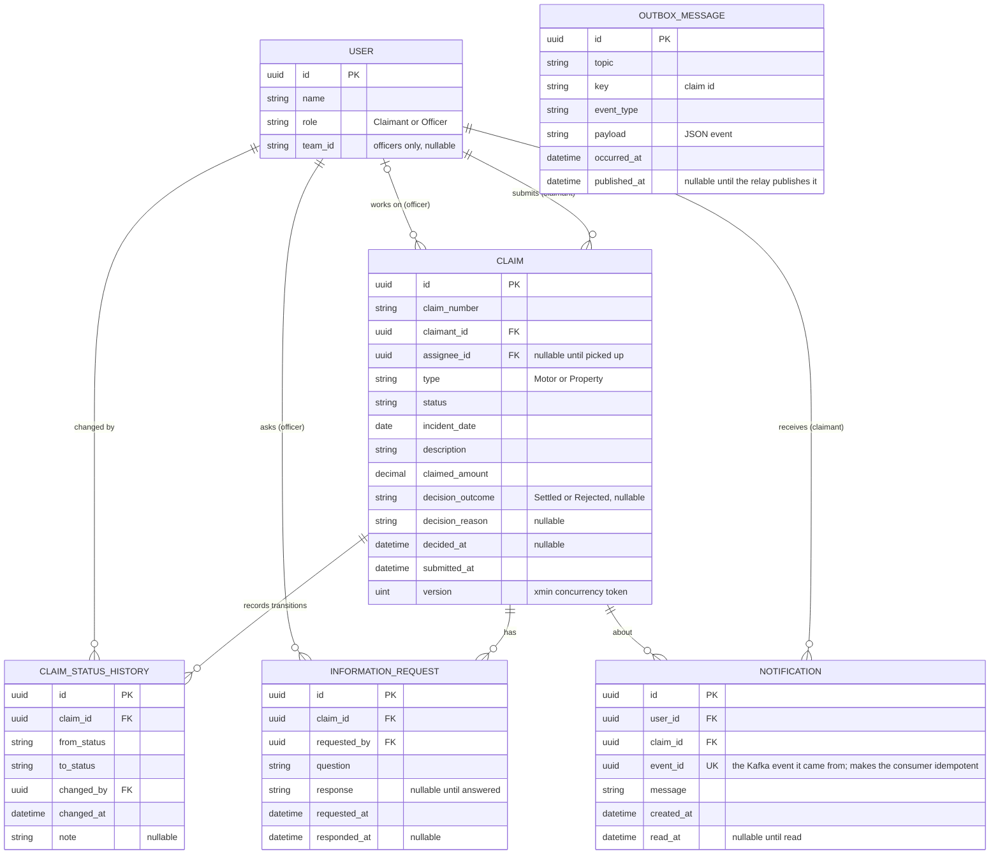

# 3. Entity relationship diagram (ERD)

Answers design question D1 (core entities and how they relate). Entities come from the nouns in the
[use cases](02-use-cases.md). It models only what R1–R8 need: no policy, attachment, market or currency modelling,
because the brief's requirements don't call for them (ADR-0011). The modelling decisions below are agreed.

**Status:** implemented. Notification and the outbox were added by RFC-0002; workload and exposure (RFC-0003) are
queries over these tables and add none.

## Diagram

`OUTBOX_MESSAGE` has no foreign keys on purpose: it is infrastructure, written in the same transaction as the claim
change and read only by the relay (ADR-0016). Published rows are deleted after 7 days.

## As implemented

Domain classes are in `backend/src/Claims.Api/Domain/` (`OutboxMessage` is in `Infrastructure/Messaging/`), EF
configuration in `Infrastructure/Persistence/Configurations/`, and the schema in the migrations `InitialCreate`,
`AddOutboxAndNotifications` and `UseSnakeCaseColumnNames`. Notes:

- Tables are `users`, `claims`, `claim_status_changes` (the status history), `information_requests`,
  `notifications` and `outbox_messages`. All names are snake_case (ADR-0019).
- `version` is the optimistic concurrency token (PostgreSQL `xmin`) that stops two officers picking up the same claim.
- Enums are stored as strings, and keys are Guid v7 generated in the domain.

## Entities and the use cases they serve

| Entity | Purpose | Use cases |
| --- | --- | --- |
| User | A claimant or a claims officer. `team_id` groups officers for the workload view. | all |
| Claim | The aggregate root. Holds the incident, current status, assignee and the decision. | UC-01, 02, 04, 05, 06, 07 |
| Claim status history | One row per status change, so tracking and performance can be derived. | UC-02, 07, 08 |
| Information request | Staff's question to the claimant and the claimant's answer. A claim can have several rounds. | UC-03, 06 |
| Notification | A message to the claimant when they are asked a question or the claim is decided, built from Kafka events. | UC-03, 04 |
| Outbox message | A claim event waiting to be published to Kafka. Infrastructure, not domain. | all transitions |

Workload and performance (UC-08), time in status (D6) and claimed exposure (D7) are queries over Claim and Claim
status history, not extra tables (ADR-0014, ADR-0015).

## Decisions

The brief does not mention policies, attachments, markets or currency, a separate decision entity, a team entity, or
reserves and payments, so they are not modelled. These are the choices the requirements left open. All three are
agreed.

| # | Decision | Chosen | Alternative not taken | Reason |
| --- | --- | --- | --- | --- |
| 1 | Information request storage | Own table, so a claim can have several rounds | `info_question` and `info_response` fields on Claim (one round) | R3 needs the question and answer stored; the brief doesn't say whether staff can ask more than once |
| 2 | Status history table | Kept, so R8 (performance) can be derived | Drop it and use `submitted_at` and `decided_at` on Claim | R8 needs performance figures; the brief doesn't say which |
| 3 | Amount field | `claimed_amount` on Claim only; assessing is a review activity, not a stored amount | Drop it too | R7 says "settlement" but the brief names no fields |

## Resolved since the first draft

- Statuses and who may trigger each transition are defined in the claim lifecycle (doc 4) and enforced in `Claim`.
- Liability exposure and the officer's workload (D6, D7) are queries over these entities, defined in RFC-0003.
