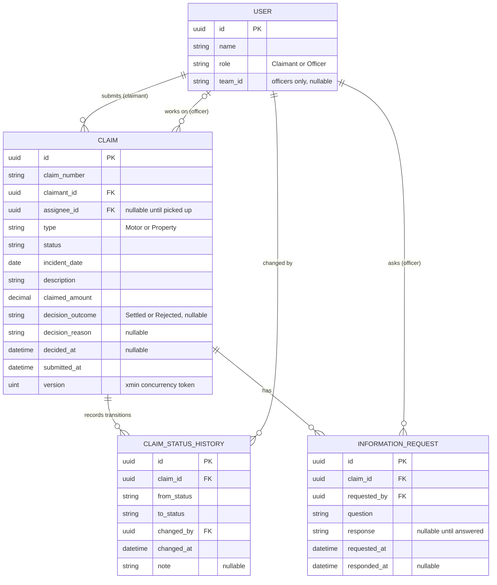

# 3. Entity relationship diagram (ERD)

Answers design question D1 (core entities and how they relate). Entities come from the nouns in the
[use cases](02-use-cases.md). It models only what R1–R8 need: no policy, attachment, market or currency modelling,
because the brief's requirements don't call for them. The modelling decisions below are agreed.

## Diagram

## As implemented

Domain classes are in `backend/src/Claims.Api/Domain/`, EF configuration in
`Infrastructure/Persistence/Configurations/`, and the schema in the `InitialCreate` migration. Notes: `version` is the optimistic concurrency token (PostgreSQL `xmin`) that stops two officers picking up the same
claim. Enums are stored as strings and keys are Guid v7 generated in the domain.

## Entities and the use cases they serve

| Entity | Purpose | Use cases |
| --- | --- | --- |
| User | A claimant or a claims officer. `team_id` groups officers for the workload view. | all |
| Claim | The aggregate root. Holds the incident, current status, assignee and the decision. | UC-01, 02, 04, 05, 06, 07 |
| Claim status history | One row per status change, so tracking and performance can be derived. | UC-02, 07, 08 |
| Information request | Staff's question to the claimant and the claimant's answer. A claim can have several rounds. | UC-03, 06 |

Workload and performance (UC-08) are queries over Claim and Claim status history, not extra tables.

## Decisions

The brief does not mention policies, attachments, markets or currency, a separate decision entity, a team entity, or
reserves and payments, so they are not modelled. These are the choices the requirements left open. All three are
agreed.

| # | Decision | Chosen | Alternative not taken | Reason |
| --- | --- | --- | --- | --- |
| 1 | Information request storage | Own table, so a claim can have several rounds | `info_question` and `info_response` fields on Claim (one round) | R3 needs the question and answer stored; the brief doesn't say whether staff can ask more than once |
| 2 | Status history table | Kept, so R8 (performance) can be derived | Drop it and use `submitted_at` and `decided_at` on Claim | R8 needs performance figures; the brief doesn't say which |
| 3 | Amount field | `claimed_amount` on Claim only; assessing is a review activity, not a stored amount | Drop it too | R7 says "settlement" but the brief names no fields |

## Open

- Statuses and who may trigger each transition are not defined here. They belong to the claim lifecycle state diagram
  (doc 4), and `status` stays a plain string until then.
- Liability exposure and the officer's workload view (D6, D7) are not answered by the ERD alone. They are queries over
  these entities, to be defined with the RFC.
