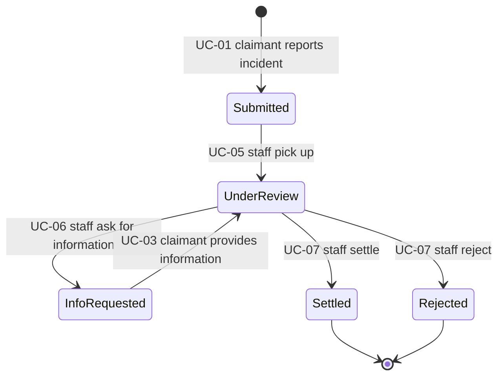

# 4. Claim lifecycle (state diagram)

Defines the statuses of a [claim](03-erd.md) and the transitions between them, with the actor who triggers each one and
the [use case](02-use-cases.md) it belongs to. This is a **proposal**: the brief doesn't name statuses, so the set below
is the smallest one that supports R1–R7. Nothing here is final until you confirm it.

**Status:** implemented in `Claim.cs` (`Domain/`), with unit tests for every transition and every rejected move.

## Diagram

## Statuses

| Status | Meaning | Terminal |
| --- | --- | --- |
| Submitted | Reported by the claimant, not yet picked up. Unassigned. | No |
| UnderReview | Assigned to a staff member who is reviewing and assessing it. | No |
| InfoRequested | Waiting for the claimant to answer a question from staff. | No |
| Settled | Decision made: claim is paid out. | Yes |
| Rejected | Decision made: claim is declined. | Yes |

## Transitions

| From | To | Trigger | Actor | Use case | Requirement | Effect on data |
| --- | --- | --- | --- | --- | --- | --- |
| (none) | Submitted | Claimant submits a report | Claimant | UC-01 | R1 | Create claim, `submitted_at` set, history row |
| Submitted | UnderReview | Staff pick the claim up | Claims staff | UC-05 | R5 | `assignee_id` set, history row |
| UnderReview | InfoRequested | Staff ask a question | Claims staff | UC-06 | R6 | Information request created, history row |
| InfoRequested | UnderReview | Claimant answers | Claimant | UC-03 | R3 | Information request `response` set, history row |
| UnderReview | Settled | Staff settle | Claims staff | UC-07 | R7 | `decision_outcome`, `decision_reason`, `decided_at` set, history row |
| UnderReview | Rejected | Staff reject | Claims staff | UC-07 | R7 | `decision_outcome`, `decision_reason`, `decided_at` set, history row |

UC-02 (track) and UC-04 (receive a decision) have no transition: they read the claim and its history. UC-08 reads
history across claims.

## Rules the model enforces

- Any move not in the table above is rejected (for example Submitted to Settled).
- Settled and Rejected are final. No transition leaves them.
- Only the assigned staff member can ask for information, settle or reject. A claimant can only answer requests on
  their own claim.
- Every transition writes one status history row, so performance can be derived from the history.
- A rejection must give a reason. A settlement reason is optional.
- Illegal moves return 409, a wrong user returns 403 (see the API error mapping in the README).

## Candidate events

Past-tense facts, keyed by claim id, per the messaging convention in AGENTS.md. Which of these go on Kafka and which
stay synchronous is decided in RFC-0002, not here.

`ClaimSubmitted`, `ClaimPickedUp`, `InformationRequested`, `InformationProvided`, `ClaimSettled`, `ClaimRejected`.

## References

Checked against real practice, not used as a source of requirements:

- Bank Negara Malaysia, *Claims Settlement Practices* (BNM/RH/PD 029-69, 1 July 2024), section 10. A public regulation
  for one of the six markets. It adds statutory working-day deadlines, a formal offer, acceptance and payment steps,
  and motor-specific rules. All of that is left out on purpose and is what I would add with more time.
- Common insurance lifecycle descriptions: [Assured](https://www.assured.com/blog/claims-processing-lifecycle-fnol-to-settlement),
  [Salesforce Trailhead](https://trailhead.salesforce.com/content/learn/modules/insurance-claims-foundations/meet-claims-management),
  [EIS Group](https://www.eisgroup.com/what-are-the-steps-in-processing-a-claim/). They agree on FNOL, triage and
  assignment, investigation, decision, payment and closure. This model covers FNOL, assignment, investigation and the
  decision, and leaves out coverage verification, reserves and closure.
