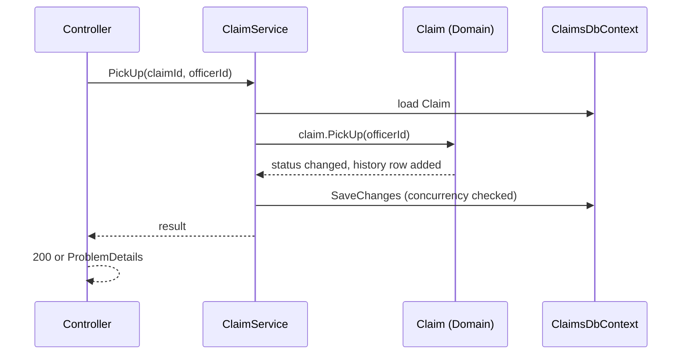

# RFC-0001: Backend architecture (.NET Web API and EF Core)

| | |
| --- | --- |
| **Status** | Accepted |
| **Author(s)** | |
| **Created** | 2026-11-25 |
| **Updated** | 2026-11-25 |
| **Related** | [RFC-0002](0002-sync-vs-async-communication.md), [ADR-0002](../adr/0002-baseline-technology-stack.md), [ADR-0006](../adr/0006-backend-layered-structure.md), [ADR-0007](../adr/0007-application-services-and-ef-core-conventions.md), design docs [3 ERD](../design/03-erd.md) and [4 claim lifecycle](../design/04-claim-lifecycle.md) |

## Summary

Build the backend as **one deployable ASP.NET Core Web API** with a layered folder structure (Controllers, Application,
Domain, Infrastructure), a lightly rich domain model where `Claim` enforces its own lifecycle rules, and EF Core with
PostgreSQL for persistence. Accepted and implemented (steps 1 to 4 below).

## Problem / motivation

The scaffold has Controllers and Infrastructure only. Before the first entity is written we need to agree where code
goes, which layer may depend on which, and how EF Core is used, so that AI-generated code is consistent and the
structure is easy to explain in the walkthrough. This RFC also answers the brief's "one service or more" question.

## Goals and non-goals

**Goals**
- A structure small enough to build the Must slice in the time available.
- Lifecycle rules (design doc 4) live in the domain, not scattered across controllers.
- Domain code has no framework dependencies (AGENTS.md).
- Persistence conventions that make migrations, seeding and concurrency predictable.

**Non-goals**
- Multiple services, a message-driven core, CQRS or event sourcing.
- The REST/Kafka split and event catalogue (RFC-0002).
- Authentication and authorisation design.

## Proposal

### 1. One service (modular monolith)

One deployable. The drivers: one transactional core (a claim, its history and its information requests change
together), a small time budget, and Kafka needed only at the edges. Splitting into services would add network
boundaries and distributed consistency problems with no benefit at this size.

### 2. Folder structure

Layer-first in a single project, with feature subfolders inside `Application/`:

```
backend/src/Claims.Api/
  Controllers/                    thin: bind, call Application, map result to HTTP
  Application/
    Claims/                       one feature folder: services, request and response DTOs, validators
  Domain/                         Claim, ClaimStatus, ClaimStatusChange, InformationRequest, User; no framework refs
  Infrastructure/
    Persistence/                  ClaimsDbContext, Configurations/, Migrations/, Seeders/
    Messaging/                    IEventPublisher, Kafka implementation (exists)
```

Dependency direction: `Controllers` → `Application` → `Domain`. `Infrastructure` supplies persistence and messaging.
`Domain` references nothing outside itself.

### 3. Application style

Plain application services (for example `ClaimService` with `Submit`, `PickUp`, `RequestInformation`, `Settle`,
`Reject`), one method per use case. No mediator library.

### 4. No repositories

Application services use `ClaimsDbContext` directly. `DbContext` already is a unit of work and a repository, so a
wrapper adds code without hiding anything worth hiding. Domain stays free of EF types.

### 5. Rich domain entities

State changes are methods on the entity, for example `claim.PickUp(officerId)` and `claim.Settle(reason, now)`. Each
checks the transition table in design doc 4 and throws a domain exception for an illegal move, which the API maps to a
`ProblemDetails` response. Each successful transition also adds a `ClaimStatusChange` row.

### 6. EF Core conventions

- One `IEntityTypeConfiguration<T>` per entity in `Infrastructure/Persistence/Configurations/`, picked up by
  `ApplyConfigurationsFromAssembly` (already wired).
- Enums stored as strings, so rows stay readable and reordering the enum is safe.
- Optimistic concurrency on `Claim` through a row version mapped to PostgreSQL `xmin`, so two officers picking up the
  same claim cannot both succeed (R5). Check the exact Npgsql mapping when implementing.
- Every schema change has a migration; migrations and the idempotent seeder run at startup (already in place).
- Domain entities are the EF entities. No separate persistence model.

### 7. Request flow



Publishing an event after `SaveChanges` is added to this flow by RFC-0002.

## Alternatives considered

| Option | Pros | Cons |
| --- | --- | --- |
| Feature-first slices (a `Claims/` folder holding everything) | Quick to navigate | Mixes domain and framework code, against the AGENTS.md rule |
| Multi-project solution (Domain, Application, Infrastructure, Api) | Compiler enforces dependencies | More project plumbing than a sprint needs |
| Minimal APIs instead of controllers | Less boilerplate; endpoint groups map well to feature folders | The scaffold, OpenAPI conventions (`ActionResult<T>`, `[ProducesResponseType]`) and AGENTS.md assume controllers; switching costs time for no graded benefit |
| Mediator and command/handler classes | Uniform use case shape | Extra dependency and indirection for about a dozen use cases |
| Repository interfaces over `DbContext` | Easier to fake in unit tests | Hides little, and tests use real Postgres (Testcontainers) anyway |
| Anemic entities with rules in services | Simple entities | Rules scatter and illegal transitions are easier to introduce |
| Microservices | Independent scaling | Distributed consistency and operational cost for no gain here |

## Risks, trade-offs and open questions

- Application services use EF directly, so `Application` depends on EF Core. Accepted; only `Domain` is kept free of it.
- A row version on the domain entity is a small persistence concern in `Domain`. Accepted for simplicity.
- Whether the layers need an automated check (for example an architecture test that `Domain` references nothing) is
  open. It is cheap to add.
- Authentication is not decided. Requests name the acting user and the service checks the role. This is a placeholder
  and is unsafe to expose.

## Rollout / implementation plan

Steps 1 to 4 are done (74 tests pass). Step 5 waits for the officer-view decision (D6) and step 6 for RFC-0002.
There is no authentication yet, so requests name the acting user and the service checks the role.

1. Domain entities and `ClaimStatus` from design docs 3 and 4, with unit tests for the transition rules.
2. EF configurations, first migration and the seeder (a few demo users).
3. `ClaimService` and controllers for the Must slice: submit, pick up, request and provide information, settle or
   reject, track.
4. Regenerate the OpenAPI contract and frontend types.
5. Workload query for R8.
6. Kafka publishing, per RFC-0002.

## Outcome

Accepted as proposed. Steps 1 to 4 are implemented and tested (74 tests, including a concurrent pick-up test against
real PostgreSQL). Resulting ADRs: [ADR-0006](../adr/0006-backend-layered-structure.md) (structure) and
[ADR-0007](../adr/0007-application-services-and-ef-core-conventions.md) (services, domain and EF Core conventions).
