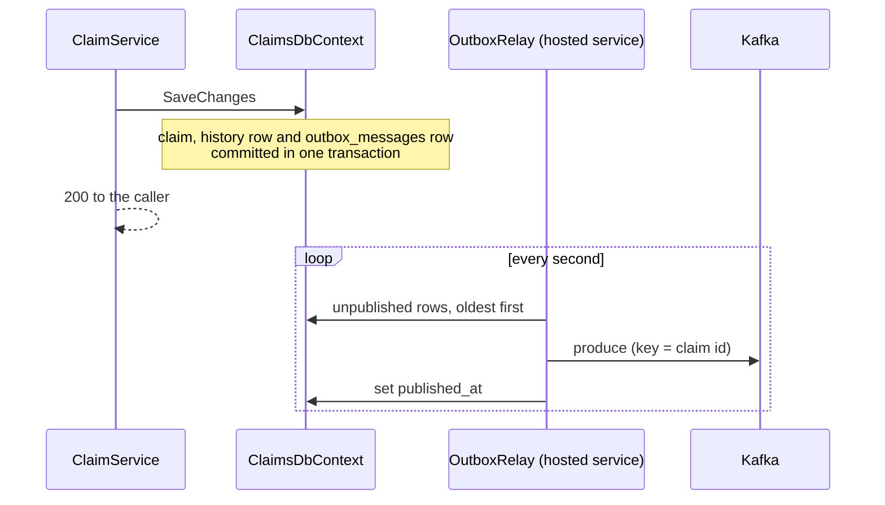

# RFC-0002: Synchronous vs asynchronous communication (REST and Kafka)

| | |
| --- | --- |
| **Status** | Implemented |
| **Author(s)** | |
| **Created** | 2026-11-25 |
| **Updated** | 2026-11-25 |
| **Related** | [RFC-0001](0001-backend-architecture.md), [ADR-0002](../adr/0002-baseline-technology-stack.md), [ADR-0003](../adr/0003-engineering-guardrails-for-ai-assisted-development.md), [ADR-0007](../adr/0007-application-services-and-ef-core-conventions.md), [ADR-0010](../adr/0010-information-requests-as-structured-questions-not-chat.md), [ADR-0013](../adr/0013-test-conventions-and-single-test-project.md), design doc [4 claim lifecycle](../design/04-claim-lifecycle.md) |

## Summary

Every action a user takes stays **synchronous REST**, because the caller needs the answer now (a 409, a 403, the
pick-up race). Every lifecycle transition is also recorded as a **past-tense event** (`ClaimSubmitted`, ...) on one
Kafka topic keyed by claim id. Events are written to a **transactional outbox** in the same `SaveChanges` as the state
change and published by a background relay, so a Kafka outage never fails or loses a REST call. **One in-process
consumer** builds claimant notifications from the events, which gives the events a real reader and closes the "no
notification yet" gap in R3/R4. The frontend learns about changes by **polling** through TanStack Query. SSE or
SignalR is left for later.

## Problem / motivation

The brief requires REST/HTTP and Kafka, and asks us to choose and justify what uses which. Claims processing is
asynchronous by nature (assessment, requests for information, decisions), and both the backend and the Angular
frontend have to handle that. Today the claimant only finds out about a question or a decision by opening the claim
again (ADR-0010, RTM R4), and nothing is published to Kafka.

## Questions this RFC must answer (from the brief)

- [x] Which operations must be synchronous? → [Interaction table](#1-interaction-table)
- [x] Which can be event-driven, and who consumes the events? → [Event catalogue](#2-topic-and-event-catalogue), [Consumer](#5-consumer-claimant-notifications)
- [x] What is the contract between frontend and backend, and who defines it? → [Contracts](#6-contracts)
- [x] How does the frontend learn that something changed asynchronously? → [Frontend updates](#7-frontend-updates)
- [x] How do the database write and the Kafka publish stay consistent? → [Outbox](#4-consistency-transactional-outbox)
- [x] Delivery semantics: idempotency, ordering, retries, dead letters → [Delivery semantics](#8-delivery-semantics)

## Goals and non-goals

**Goals**
- A REST/Kafka split that is easy to explain: commands and queries over REST, facts over Kafka.
- No event lost, and no REST call failed, because Kafka is slow or down.
- At least one consumer that does something a user can see.

**Non-goals**
- Event sourcing or CQRS. The tables stay the source of truth; events are notifications of change.
- Splitting into services (ADR-0006). The consumer runs in the same process.
- Email, SMS or real-time push (ADR-0010).
- A schema registry or Avro/Protobuf.

## Current baseline (already in the scaffold)

- REST: ASP.NET Core controllers; the OpenAPI document is exported on build to `backend/openapi/claims-api.json`,
  and the frontend types are generated from it (`npm run api:generate`). **The backend owns the contract.**
- Kafka: `IEventPublisher` (idempotent producer, `acks=all`, JSON payloads keyed by aggregate id), a consumer
  background service skeleton that commits every message without handling it, and an empty `Topics.cs`.
- Compose runs the broker with `KAFKA_AUTO_CREATE_TOPICS_ENABLE: "true"`.
- The SPA refetches on window focus and after a 30 s stale time; there is no polling.

## Proposal

### 1. Interaction table

| Interaction | Style | Why |
| --- | --- | --- |
| Submit, pick up, request information, provide information, settle, reject (UC-01, 03, 05, 06, 07) | REST command | The user needs the result now: validation (400), wrong user (403), illegal move or lost pick-up race (409) |
| Track a claim, list claims, staff queue (UC-02, 04, 05, 08) | REST query | Read your own writes; the database is the source of truth |
| Lifecycle facts for other parts of the business | Kafka event | Nobody waits for them; readers are decoupled from the claims service and may be added later |
| Claimant notifications (R3 "when asked", R4 decision) | Kafka consumer → table → REST query | The notification is a side effect of a transition and must not slow or fail the command |
| SPA sees changes made by the other party | REST polling | See [section 7](#7-frontend-updates) |

Rule of thumb for the walkthrough: **if the caller needs to know whether it worked, it is REST; if it is a fact that
already happened, it is an event.**

### 2. Topic and event catalogue

One topic, `claims.claim-events`, keyed by claim id, so all events of one claim land on one partition in order.
Topic names live in `Topics.cs`.

| Event | Raised by | Data (besides the envelope) |
| --- | --- | --- |
| `ClaimSubmitted` | `Claim.Submit` | `claimNumber`, `claimantId`, `type`, `incidentDate`, `claimedAmount` |
| `ClaimPickedUp` | `Claim.PickUp` | `assigneeId` |
| `InformationRequested` | `Claim.RequestInformation` | `informationRequestId`, `question` |
| `InformationProvided` | `Claim.ProvideInformation` | `informationRequestId` |
| `ClaimSettled` | `Claim.Settle` | `reason` |
| `ClaimRejected` | `Claim.Reject` | `reason` |

Events carry ids and the facts a reader needs to act, not the whole claim. A reader that needs more calls the REST API.

**Envelope** (JSON, `JsonSerializerOptions.Web`):

```json
{
  "eventId": "0193...",          // Guid v7, also the idempotency key
  "eventType": "ClaimPickedUp",
  "schemaVersion": 1,
  "occurredAt": "2026-11-25T10:00:00Z",
  "claimId": "0193...",
  "data": { "assigneeId": "0193..." }
}
```

`eventType` is also sent as a Kafka header so a consumer can route without parsing the body.

**Why one topic, not one per event:** per-claim ordering only holds within one partition of one topic. A notification
reader must never see `ClaimSettled` before `ClaimPickedUp`.

**Topic creation:** the API creates the topic and its dead-letter topic at startup with the admin client (3
partitions, replication factor 1 on the single-node broker). Auto-create is turned off in Compose, so a typo in a topic
name fails loudly.

### 3. Raising events in the domain

`Claim` already owns its transitions (ADR-0007). Each transition also appends a domain event to a list on the
entity (`Claim.DomainEvents`), using plain records in `Domain/Events/`. No framework types, so `Domain` stays clean.
The service code does not change: it still calls the method and `SaveChanges`.

### 4. Consistency: transactional outbox



- `ClaimsDbContext.SaveChangesAsync` collects `DomainEvents` from tracked claims, writes one `outbox_messages` row per
  event (`id`, `topic`, `key`, `event_type`, `payload`, `occurred_at`, `published_at`), and clears the list.
  One migration adds the table.
- `OutboxRelay` publishes unpublished rows in `occurred_at` order and marks each one published after Kafka acks it.
  If Kafka is down it logs, waits and retries; REST calls are unaffected.
- The producer gets a short `message.timeout.ms` (10 s) so a dead broker does not stall the relay for the 5-minute
  default.
- A crash between the ack and `published_at` republishes the row, so delivery is **at least once**. Consumers dedupe
  on `eventId`.
- One API instance is assumed. With several, the relay would need `FOR UPDATE SKIP LOCKED` or a leader; noted, not built.
- Published rows are kept (they double as an event log for the demo). Clean-up is "with more time".

### 5. Consumer: claimant notifications

`KafkaConsumerService` gets handler dispatch by `eventType`. One handler, `ClaimantNotificationHandler`:

- `InformationRequested` → "Your claim needs more information"; `ClaimSettled` / `ClaimRejected` → "A decision has
  been made on your claim". Other events are ignored.
- Writes a `notifications` row (`id`, `user_id`, `claim_id`, `event_id` unique, `message`, `created_at`, `read_at`) and
  the dedupe check in one transaction: a second copy of the same event hits the unique `event_id` and is skipped.
- Read through REST: `GET /api/notifications` and `POST /api/notifications/{id}/read`, naming the acting user the
  same way the claims endpoints do until authentication exists (ADR-0009).
- The claimant needs the claim's owner, which the event does not carry for `InformationRequested`. The handler reads it
  from the database; the consumer is in-process and shares the context.

This is the smallest consumer that a user can see, and it answers the RTM note on R4 ("No notification yet").
**Scope:** the brief does not name notifications. The owner decided to keep them (open question 1).

### 6. Contracts

- **REST:** unchanged. The backend owns it; OpenAPI is exported on build and the frontend types are generated.
- **Events:** the backend owns them too. The C# records in `Domain/Events/` are the source; this RFC's catalogue is the
  documentation. Changes are additive within a `schemaVersion`; a breaking change bumps the version. No schema
  registry for a single-producer system.

### 7. Frontend updates

- Polling with TanStack Query: `refetchInterval: 10_000` on the claim detail query and the claim list queries, with
  `refetchIntervalInBackground: false` so hidden tabs stop polling. Mutations already invalidate their keys.
- A notifications query (badge in the toolbar for claimants) uses the same interval.
- **Why not SSE or SignalR:** a second channel, reconnection and a fan-out consumer for a demo with a handful of users.
  Polling is one option per query and is easy to test. Push is "with more time"; the consumer in section 5 would feed it.

### 8. Delivery semantics

| Concern | Decision |
| --- | --- |
| Producer | Idempotent, `acks=all` (existing), 10 s message timeout |
| Delivery | At least once, end to end (outbox + commit after handling) |
| Ordering | Per claim: one topic, key = claim id, relay publishes in `occurred_at` order |
| Consumer idempotency | Unique `event_id` on the projection row, in the handler's transaction |
| Offset commit | After the handler's transaction commits, never before (fixes the skeleton) |
| Retries | 3 attempts in the consumer with a short back-off |
| Poison messages | After the retries, the message goes to `claims.claim-events.dlt` with the error in a header, and the offset is committed |
| Consumer crash | Unexpected exceptions are logged and the loop keeps running; today only cancellation is caught |

### 9. Health and configuration

- `/health/ready` stays Postgres only: the API serves REST without Kafka, which is the point of the outbox.
  Outbox lag (oldest unpublished row) is logged by the relay.
- `Kafka:ConsumerEnabled` becomes true in Development and Compose; tests turn it on in the shared factory.
- `SubscribeTopics` is replaced by the handler registrations.

## Alternatives considered

| Option | Pros | Cons |
| --- | --- | --- |
| Publish after `SaveChanges` (dual write), as RFC-0001 sketched | No table, no relay | Event lost if the publish fails after the commit; a dead broker fails or stalls the REST call |
| Publish before `SaveChanges` | — | Event for a change that may roll back (concurrency conflict) |
| Kafka transactions / EF in a distributed transaction | Exactly once in theory | Not supported across Postgres and Kafka; heavy |
| Debezium CDC on the outbox | No relay code | Another container and connector config for a 5-hour budget |
| Commands over Kafka (submit via a topic) | Fully async | The caller loses the 400/403/409 answer; the frontend needs a correlation and status endpoint |
| One topic per event type | Readers subscribe to only what they want | No ordering across a claim's events |
| No consumer (events for "future readers" only) | Least work | The split is hard to justify when nothing reads the events |
| Workload/statistics projection as the consumer (R8) | Uses events for D6 | R8 waits on the officer-view decision; a SQL query over the history is simpler |
| SSE or SignalR for updates | Instant | Extra infrastructure; see section 7 |

## Risks, trade-offs and open questions

1. **Scope (decided: keep notifications):** the notifications consumer, table and two endpoints are not named in the
   brief. The smaller alternative, an audit-log consumer that writes events to a table, was considered and not chosen
   because it gives the user nothing to see. Both need the outbox.
2. At least once means a consumer may see an event twice. Every new consumer must dedupe; this is a rule, not a library.
3. The outbox adds one table, one migration and one hosted service. That is the price of not losing events.
4. A poll every 10 s per open tab is fine at demo scale, not at production scale.
5. Single-instance assumption for the relay (section 4).
6. **Before building (resolved):** ADR-0002 and ADR-0003 were still Proposed and this work builds on both; both are
   now Accepted. The exception to ADR-0013's `R{n}_...` naming for constraint-traced tests is ADR-0020.

## Rollout / implementation plan

1. Accept ADR-0002 and ADR-0003; amend ADR-0013 for constraint-traced tests.
2. Domain events on `Claim` and their unit tests (one per transition).
3. Outbox table and migration, `SaveChanges` hook, `OutboxRelay`, topic creation at startup, auto-create off in
   Compose. Integration test per transition: the REST call leads to the event on the topic, in order.
4. Consumer dispatch, retries, dead-letter topic and commit after handling. Integration tests for the duplicate and
   poison cases.
5. Notification handler, table, endpoints, OpenAPI regeneration.
6. Frontend: polling intervals, notifications badge and list, unit and e2e tests.
7. Update the RTM (R3, R4 implementation column), design doc 4 (candidate events become the catalogue), scope doc
   (D3, D5 done).

## Outcome

Built as proposed. Recorded in [ADR-0016](../adr/0016-rest-for-commands-kafka-for-lifecycle-events-via-outbox.md)
(REST and Kafka split, outbox, at-least-once), [ADR-0017](../adr/0017-frontend-learns-of-changes-by-polling.md)
(polling) and [ADR-0018](../adr/0018-claimant-notifications-built-by-a-kafka-consumer.md) (notifications consumer).

Differences from the draft: column names are snake_case as drafted, through a naming convention for the whole schema
([ADR-0019](../adr/0019-snake-case-database-names.md)); the producer is created on first use so the host starts without a broker; the consumer
subscribes to the event topic directly, so `Kafka:SubscribeTopics` was removed. Constraint-traced test names (`C3_*`) are covered by [ADR-0020](../adr/0020-constraint-traced-tests-use-c-prefix.md),
and `BrokerOutageTests` proves a stopped broker neither fails REST nor loses the event. A notification e2e spec and a
full `docker compose` run (existing database, auto-create off) also pass. The relay deletes published outbox rows older than `Kafka:OutboxRetentionDays` (7) once an hour; unpublished
rows are never deleted. Nothing from the RFC is left unbuilt.
